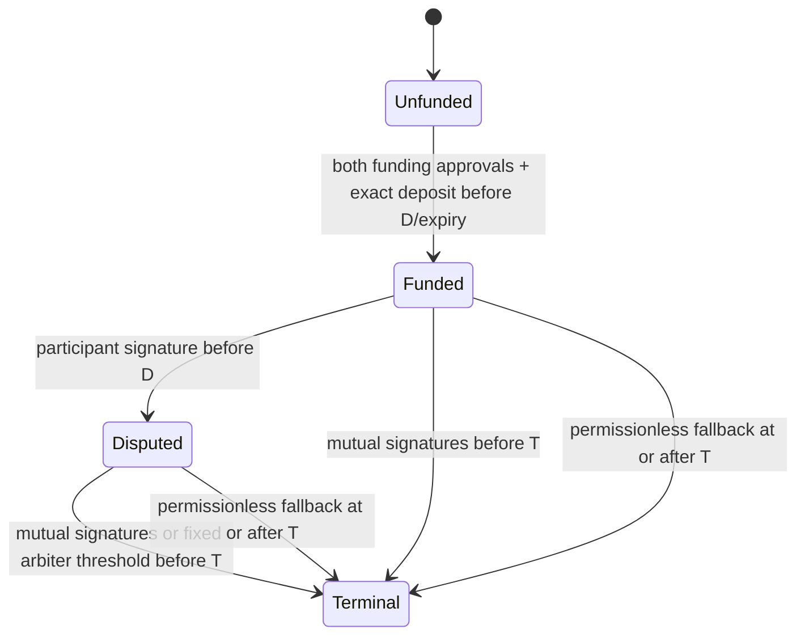

# M2 design register — conditional direction accepted, interfaces provisional

Updated 2026-11-06. Branch `feature/m2-base-usdc-escrow`, PR #119. Baseline staging `5e30d6eb336087b65dde3ffdb880abf07d7c0c78` includes PR #118. [M2 specification](../../M2_NATIVE_USDC_BASE_SEPOLIA_SPEC.md) and [M0 product approval](M0-PRODUCT-APPROVAL.md) remain authoritative.

## Acceptance record and authority limits

The repository owner, in the explicit continuation instruction for this task, reviewed the eight prior proposals and granted **conditional architecture-direction acceptance for M2.1**. The instruction authorizes deterministic local M2.2–M2.6 implementation using mock tokens and a local EVM while network verification is incomplete. It expressly does **not** grant independent engineering, contract-security, legal, financial or deployment approval. No independent reviewer/sign-off is recorded. No public deployment, public-network broadcast, funds, merge, main changes or M3 are authorized. The subsequent continuation authorizes disposable local-EVM lifecycle transactions only.

Independent provider agreement and verified token implementation/provenance are activation gates, not blockers to this authorized local work. The prior G0-only pause is superseded by this instruction; the remaining gates are not waived. Solidity interfaces remain `2-local-review-2` and **unfrozen**.

| # | Accepted direction | Local realization / outstanding review |
| --- | --- | --- |
| 1 | Immutable per-milestone instances; benchmark full deployment versus pinned minimal clones before factory freeze | Constructor-only full escrow/factory implemented. Equivalent shared-logic benchmark (two EOA arbiters) measured full 2,488,411 gas and atomically initialized pinned clone 630,726 gas, excluding one-time implementation deployment. Both execute the lifecycle suite. Prefer full deployment for the initial candidate to avoid external initializer/delegatecall complexity; final independent review and ABI freeze remain open. |
| 2 | Both participants cryptographically approve identical immutable terms; exact atomic funding | EOA/ERC-1271 participant verification, client debit and escrow credit checked exactly; invalid approval/transfer reverts all state. No API key authority. |
| 3 | Distinct EIP-712 funding/mutual/dispute/arbitration authorizations; vectors before ABI freeze | TypeScript codec and Solidity cross-check four canonical digests plus terms hash. Chain/instance/domain/action binding; cryptographically advanced action epochs; dispute remains single-use nonce zero. ABI not frozen. |
| 4 | Immutable directly verified EOA arbiter set/threshold; no mutable verifier/admin override | Sorted unique set, threshold in signed terms, exactly threshold distinct signatures; code-bearing/delegated arbiters rejected at creation/execution. No default threshold, rotation or recovery. Disabled arbitration requires empty set/zero threshold. |
| 5 | D < T; signed invocation before D; settlement before T; committed permissionless fallback from T | Exact `< D`, `< T`, `>= T`; one terminal guard across mutual/arbitral/fallback. Failed transfers revert terminal state. |
| 6 | Pinned Base Sepolia test USDC; exact accounting, safe transfers, reentrancy guard, no sweep; external issuer/proxy trust explicit | Provisional factory checks chain/address. Local factory/mock are separate test classes. No registry activation. SafeERC20 + sender/recipient deltas; donations remain surplus. Proxy implementation/provenance remains unverified. |
| 7 | W-based approved fee algorithm, per-party <=1000 bps, checked arithmetic/conservation; no B2B billing | OZ Math.mulDiv floor; P+reserve bounded, four fee modes, dust/max and fuzz assertions. No billing implementation. |
| 8 | Durable evidence, fail-closed finality; independent provider/provenance activation gates | Local-only encrypted immutable artifact and evidence tables; local outbox/worker, signed transaction verification, historical sweeps and sticky correction. No live broadcaster/observer/activation. Single-provider manifest remains evidence only. |

## Explicit technical review of provisional details

This is an **author self-review**, not independent engineering/security verification. The following choices are documented so they cannot silently become policy through an ABI freeze:

| Question | Technical disposition | Acceptance needed before freeze |
| --- | --- | --- |
| Exact threshold/recovery | Each escrow explicitly supplies 1..N threshold and sorted set (N<=16 implementation bound); participants sign both. No platform default. No replacement/rotation; loss uses committed fallback. ECDSA recovery remains fixed even if accounts later delegate code; delegated accounts are rejected, leaving fallback. | Owner accepts explicit immutable thresholds, maximum 16 and fallback on lost keys. Independent security review remains open; no default threshold. |
| Funding window | Owner requires execution before D with a versioned minimum interval. Policy 1 candidate requires 30..604800 seconds; execution <=D-minInterval and <expiry<=D. Exact equality is tested. | Direction accepted; numerical bounds are proposed local bounds, not an approved safe operational interval. Specialist review before freeze. |
| Address aliases | Candidate rejects client=worker, treasury=participant, and token/escrow addresses as recipients to keep exact-delta accounting and identities unambiguous. | Owner accepts distinct client/worker/treasury addresses for this version. This proves no distinct human ownership. |
| Participant ERC-1271 mutability | Signature checked onchain at execution. Same contract address can change human owners; old signatures can become invalid. This does not freeze wallet internals. Arbiters use stricter direct ECDSA. | Specialist review and explicit participant-facing disclosure before a real signing flow. |
| Nonce and replacement | Separate funding/mutual/arbitration epochs advance only with signed onchain cancellation. Either participant cancels funding or mutual; immutable arbiter threshold cancels arbitration. Dispute cannot be vetoed. Replacement requires new signatures at the advanced epoch. | Owner requests revocable intents; this precise policy remains a technical-review candidate. No ABI freeze or independent approval. |
| Clone comparison | Both candidates share the same core; full contract has constructor-only initialization, clone implementation is locked and the local clone factory initializes atomically. Equivalent initialization costs are measured; full remains the simpler proposed deployment. | Independent initializer/delegatecall and full-factory review still needed; no production clone path is supplied. |
| Durable operation replacement | Earlier immutable prototype remains intact. New command/outbox model retains signed bytes and explicitly links same-nonce successors at higher onchain epochs; no DB-only revocation. | Local restart/lost-response/replacement tests pass; live nonce management, fee replacement and operational recovery remain gated. Never delete signed evidence. |
| Persistence ownership | New explicitly LOCAL aggregate references app/agreement/milestone and enforces chain 31337; no legacy Escrow relabeling or M1 constraint changes. | Two new forward migrations add local commands/outbox/evidence and explicit nonce replacement. Live aggregate and activation remain unapproved. |
| Finality sources | Local two-provider adapter tests canonical/receipt/state matching. Provider independence must be trusted reviewed configuration, not an app-supplied label. | Actual independent Base operator agreement, finalized/L1 semantics and historical sweep operations remain activation work. |

No material commercial choice above is marked accepted merely because code/tests exist. Proceeding with local candidates does not freeze them.

## Local state and authority model

No terminal transition can run twice; state changes precede external token calls under nonreentrancy, and transfer failure rolls back the transaction. Direct donations are not funding. Ordinary native ETH calls revert; forced ETH/token donations are stranded surplus without an operator sweep. Chain outage, gas, token blacklist/pause and compromised/lost keys can still impair receipt.

| Actor | Authority |
| --- | --- |
| Both original participants | Identical complete funding terms and mutual allocations, verified EOA/ERC-1271 |
| Either original participant | Signed dispute invocation before D |
| Immutable EOA arbiter threshold | Allocation after invocation and before T, no recipient/fee/deadline changes |
| Any relayer | Submit valid authorizations or invoke fixed fallback at/after T; relayer identity grants nothing |
| Application API key | Public proposal route rejects; separate authenticated loopback harness verifies consent and signed transactions |
| Factory/operator | No funds authority, upgrade, owner, sweep or deadline extension |

## Exact codec and conservation

Canonical source: [Solidity](../../contracts/evm/src/PactEscrow.sol), [TypeScript](../../server/src/modules/base/codec.ts), [vectors](../../contracts/evm/test/vectors.json). Domain: `PactAgentEscrow`, version `2-local-review-2`, execution chain ID, verifying instance. Application/M1 SHA-256 commitments are opaque terms fields, **not** the EIP-712 digest.

Terms encode bytes32 app/agreement/milestone/escrow/application commitments; token, original client/worker and treasury; uint256 principal, client/worker bps, fallback worker share, D/T, threshold, intervalPolicy and minDisputeInterval; bytes32 fee policy and arbiter set hash. Set hash is Keccak of Solidity `abi.encode(address[])` (offset, count, ordered padded addresses). Client fallback share is derived as P minus committed worker share. Contract version is bound by the domain. Action type strings and field widths are checked into both codecs; all uint256 strings must be canonical nonnegative decimal.

Distinct actions: `FundingApproval`, `MutualSettlement`, `DisputeInvocation`, `ArbitralSettlement`. Every action binds termsHash, its epoch and validUntil; settlement adds W and C. Dispute uses nonce zero. CancelIntent separately binds termsHash, action index, exact epoch and validUntil. Validity is exclusive (`timestamp < validUntil`). State guards consume each action. Reordered, repeated, malformed or wrong identities do not become distinct approvals.

`W+C=P`; `R=floor(P*bc/10000)`; `Fc=floor(W*bc/10000)`; `Fw=floor(W*bw/10000)`.

`clientNet=C+R-Fc`; `workerNet=W-Fw`; `treasuryNet=Fc+Fw`; sum=`P+R`.

Since W<=P, Fc<=R; rates<=1000 ensure Fw<=W. Full refund earns no fee and returns reserve. Full worker payment earns all client reserve. Every path uses the same allocation function. Checked Math.mulDiv avoids intermediate multiplication overflow; funding must fit uint256. PostgreSQL M1 exact `div` and serialization correction remain unchanged.

## Network evidence and release gates

[Manifest](evidence/m2/network-manifest.json) and [RPC observation](evidence/m2/rpc-observation.json) retain the original source/retrieval/code evidence. Circle lists `0x036CbD53842c5426634e7929541eC2318f3dCF7e`; Base's current [connection page](https://docs.base.org/get-started/connect-to-base) lists 84532. Initial HTTP403 attempts were followed by a successful single-provider observation of code, six decimals and canonical finalized block `0x3257e05`. No independent agreement/proxy implementation/deployment provenance is claimed. Factory/escrow deployment addresses remain null. No code template hash grants a capability.

[Base finality documentation](https://docs.base.org/specifications/transactions/transaction-finality) distinguishes Flashblock, L2 inclusion, L1 batch inclusion and L1 batch finality. Approximate timings are not policy constants. L1 withdrawal windows are not escrow payment finality. No fallback to latest or inferred paid status is allowed.

| Gate | Evidence / status |
| --- | --- |
| M2.1 direction | Owner conditional acceptance recorded above; local work authorized |
| ABI/factory/policy freeze | Open questions above; no independent technical acceptance |
| G1 local implementation review | Local tests exist; independent engineering and contract-security review still absent |
| Network activation | Independent sources, proxy implementation/provenance, deployment identity, reliable observer/storage/incident policy still incomplete |
| G2 deployment | Explicitly forbidden by current instruction |
| G3 production / M3 | Outside scope; no legal/financial/production approval |

## Product-direction continuation — 2026-11-06

The owner accepts funding before D with a configurable/versioned invocation interval,
distinct participant/treasury addresses and immutable explicit EOA signer sets of at
most 16. The owner requests replacement of the non-revocable intent model. These
are product directions only; independent engineering, contract-security, legal,
financial and deployment approvals remain absent.

Policy 1 encodes a **proposed local range of 30 seconds to seven days**. Thirty
seconds is an adversarial test lower bound, not a safe human response guarantee.
Recommend evaluating at least one hour for attended test workflows and materially
longer for unattended participants, against outage/detection/response budgets.
Neither recommendation is a default or approved production policy. Participants sign
the exact version and interval. Funding at D-interval succeeds if expiry permits;
one second later and at D fail. Creation requires enough remaining time. No funded
terms or deadlines can be extended. Bounds/default UX require technical review and
owner acceptance if their practical policy changes.

Cancellation has exclusive expiry and is unavailable at/after T or after settlement.
The first successfully ordered onchain transition wins: cancellation invalidates
prior epochs, but cannot undo an earlier funding/settlement. A newly signed proposal
alone does not revoke an older one. Funding cancellation requires either original
participant while unfunded; mutual cancellation either while funded/disputed;
arbitral cancellation the immutable threshold while disputed. Cancellation advances
only its own action, changes no allocations/terms/deadlines, and cannot stop fallback.
Signed dispute invocation is deliberately irrevocable to avoid either participant
vetoing the other's right to invoke arbitration. Review this distinction explicitly.

See [local engineering self-review](M2-LOCAL-ENGINEERING-REVIEW.md) for race,
replacement and operational constraints. The domain is intentionally changed;
old review-1 signatures are not reusable. No existing deployed contract or funded
CKB record is migrated. **ABI and factory remain unfrozen pending technical review.**
