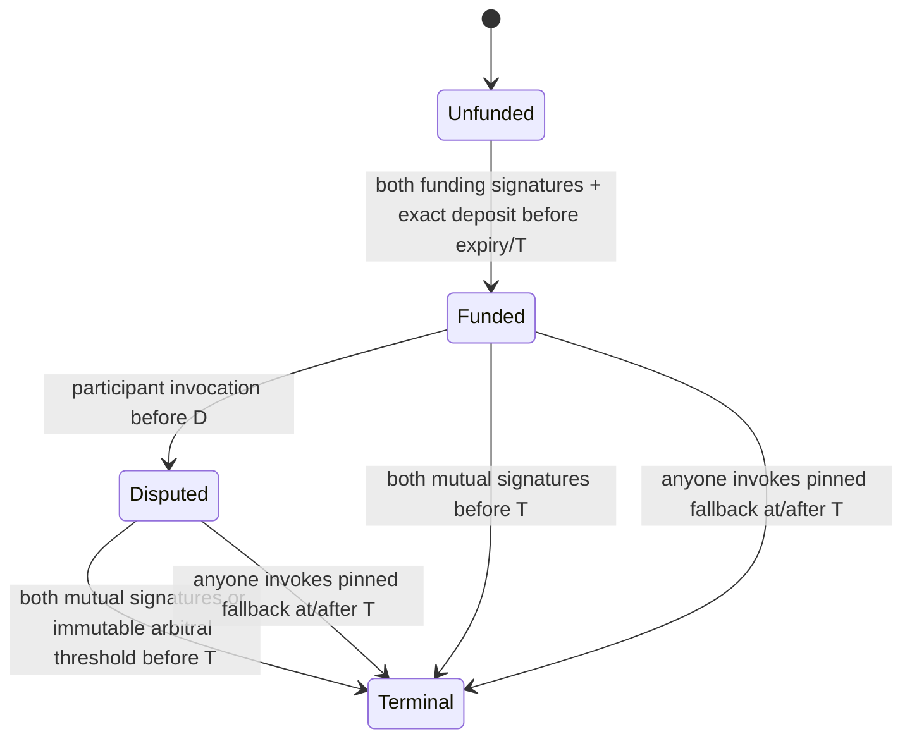

# M2 design review — Base Sepolia USDC

Status: **proposed, G0 incomplete; not an approved ABI or financial implementation**.
Prepared 2026-10-31 against staging `5e30d6eb336087b65dde3ffdb880abf07d7c0c78`, including corrective PR #118. Scope: [M2 specification](../../M2_NATIVE_USDC_BASE_SEPOLIA_SPEC.md). Product approval remains [M0-PRODUCT-APPROVAL](M0-PRODUCT-APPROVAL.md); it is not specialist security approval.

## Decisions for review

| Decision | Proposed choice and alternatives | Evidence / remaining gate |
| --- | --- | --- |
| 1. Deployment | Full non-upgradeable escrow per milestone; factory only constructs/indexes, no owner/admin. Prefer simpler constructor binding over clones and initializer races. No CREATE2 address serves as proof of deployed code. | No gas comparison yet: measure full deployment against pinned clones in local EVM before selecting/finalizing. No bytecode/deployed address exists. |
| 2. Funding | Two steps: deploy unfunded immutable terms; `fund` verifies both parties' complete EIP-712 approvals and atomically transfers the exact principal plus client reserve from the pinned client. Invalid/missing approval reverts without transfer. Funding approval has expiry strictly before T. No participant seeds/server signing. | Predictable instance domain and no trapped funds on absent consent. Approval/permit alone is not terms consent. EOA and ERC-1271 must be executed, not inferred from signature bytes. |
| 3. Settlement | Separate typed actions for funding, mutual settlement and arbitration; instance EIP-712 domain, full immutable terms hash, nonce, W/C, validity. Both original participant identities must validate the same mutual intent. | Draft schema below; not implemented, no canonical cross-language digest vectors yet. M1 SHA-256 is only an application commitment. |
| 4. Arbitration | Optional fixed EOA signer list and threshold, directly checked by escrow; canonical sorted unique recovered signers, no external mutable verifier. Bind list/threshold to funding terms. An app selects the proposal; both participants accept. | Reject contract accounts as arbitral authorities initially. Contract-wallet participants can use ERC-1271, but mutable participant wallet ownership is an explicit consent risk; architecture review must accept this distinction. No Safe-address-only threshold. No post-funding rotation or recovery override. |
| 5. Liveness | Arbitration invocation by either original participant with explicit signed invocation before D; D < T. Mutual and invoked arbitral settlement only while timestamp < T. Permissionless fallback at timestamp >= T, with precommitted W/C. | At D invocation fails; at T mutual/arbitration fail, fallback succeeds. Existing invoked dispute may settle between D and T. All terminal branches share one transition guard; no extension or pause admin. D/T and fallback allocations are per-escrow mutually accepted terms, not platform-imposed commercial defaults. |
| 6. Token | Only reviewed Circle test token on 84532. SafeERC20 semantics plus balance-delta checks on funding and every recipient transfer; reject non-exact movement. Nonreentrant terminal path, state-before-external-call and whole-transaction rollback. | Issuer proxy upgrades/blacklists/pause remain external trust. Token address/hash alone cannot prove implementation immutability. Track implementation evidence and fail closed on changes. No operator sweep. Direct token donations remain unaccounted surplus; forced native ETH is stranded, ordinary payable calls rejected. |
| 7. Fees | All approved fee modes, each rate <= 1000 bps. Freeze treasury/version, reserve and rates at funding; settle W-based fees. No B2B billing. | Solidity use reviewed full-precision floor mulDiv (or equivalent proved quotient decomposition); do not multiply uint256 then divide unchecked. Bound P + reserve <= uint256 max. See conservation below. |
| 8. Finality | Separate submitted/included/finalized evidence. Require independent agreeing providers, canonical finalized ancestry, expected emitter/state/token/amounts and pinned policy. Historical sweeps detect changed/absent receipts. | Single-provider finalized and hash-pinned reads observed; independent agreement and L1 anchoring remain unverified. No fixed elapsed-time or block-count substitute. No fallback to latest. Finalized projection remains correctable and never authorizes another payout. |

## Network evidence and activation boundary

[Versioned evidence manifest](evidence/m2/network-manifest.json) records official source URLs, retrieval dates, document SHA-256, expected identity and unknown observations. Base's old `/chain/connect` URL returned 404; current official [connection page](https://docs.base.org/get-started/connect-to-base) lists 84532 and `https://sepolia.base.org`. [Circle](https://developers.circle.com/stablecoins/usdc-contract-addresses) lists `0x036CbD53842c5426634e7929541eC2318f3dCF7e` for Base Sepolia. This is **test USDC**, not the escrow address, not verified token code and not a deployment permission.

Initial public RPC attempts for chain ID, finalized block, code and decimals returned HTTP 403. A later Node fetch retry succeeded; see [raw observation](evidence/m2/rpc-observation.json): chain 84532, decimals 6, code and canonical finalized block `0x3257e05`. The manifest records the observed code Keccak-256 computed with installed @noble/hashes 2.4.0. This verifies only what one provider reported at that block, not independent provider agreement, proxy implementation or deployment provenance. Those remain unverified. Factory/escrow addresses remain null. Do not manufacture these fields from expected values. A successful single-provider read would still not close G0/G2.

[Base finality documentation](https://docs.base.org/specifications/transactions/transaction-finality) distinguishes Flashblock (~200ms), L2 inclusion (~2s), L1 batch inclusion (~2m), and L1 batch finality (~20m). These are descriptive approximations, not escrow confirmation policy or demonstrated Sepolia RPC behavior. L1 withdrawal challenge periods are not payment finality. Establish finalized-tag semantics and provider independence before implementation is treated as verified.

M1 `BASE_SEPOLIA_CANDIDATE` remains unavailable and unchanged. Future verified Base identities need a new versioned asset and deployment record, never mutation of existing asset IDs to grant capabilities. SHA-256 evidence digests are not EVM Keccak code hashes. The read-only probe cannot approve a manifest or activate anything.

## Proposed state and authority

Failed token/signature calls revert the entire transition. Unfunded instances expire without accepting deposits; directly transferred tokens cannot be prevented by escrow code and are not recognized funding.

| Actor | May authorize | Must never authorize |
| --- | --- | --- |
| Client + worker | Identical funding terms; identical mutual allocation | Redirect to new recipients/treasury after funding |
| Either participant | Cryptographic dispute invocation before D | Unilateral arbitrary allocation |
| Fixed arbiter threshold | Allocation after valid invocation and before T | Change participants, fees, deadline, signer set or recipients |
| Any submitter | Relay valid intent or invoke fallback at T | Derive authority from relayer identity |
| App API key | Tenant-scoped proposals/status/artifact submission | Transfer funds, forge signatures, mark paid |
| Operator/factory | Deploy/index only when separately authorized | Upgrade, sweep principal, extend deadline or override verdict |
| Observer | Evidence-derived projection and correction | Trigger second payout following ambiguous/reorg result |

ERC-1271 participant validation is evaluated on chain at execution. Changing a wallet's owners can revoke old signatures or change who controls the same wallet; terms cannot freeze arbitrary wallet internals. Do not claim both human individuals remain identical over time. Reject unsupported wallet semantics; document this limitation in the signing preview. Arbitrators require stricter fixed EOA identity because the specification requires frozen authority/dependencies. Key loss/compromise uses only the precommitted fallback, with no operator remedy.

## Proposed signing codec (not an ABI commitment)

EIP-712 domain: `name = PactAgentEscrow`, `version = 2-draft`, `chainId = 84532`, `verifyingContract = instance`. The draft version must not appear in funded instances. Use canonical ABI encoding and Ethereum Keccak-256, not JSON serialization or M1 application hashing.

Draft `Terms` binds `termsVersion`, `appCommitment`, `agreementCommitment`, `milestoneCommitment`, `escrowId`, `token`, `client`, `worker`, `principal`, `clientFeeBps`, `workerFeeBps`, `treasury`, `feePolicyVersion`, `fallbackWorker`, `fallbackClient`, `disputeDeadline`, `finalDeadline`, `arbiterSetHash`, `arbiterThreshold`, and `applicationCommitment`. Commitments are bytes32 opaque IDs without personal data. Amounts/times are uint256; rates/thresholds use explicit reviewed widths before ABI freeze. All dynamic list hashes require documented element order/encoding.

Draft distinct type names:

- `FundingApproval(bytes32 termsHash,uint256 nonce,uint256 validUntil)`
- `MutualSettlement(bytes32 termsHash,uint256 workerAmount,uint256 clientAmount,uint256 nonce,uint256 validUntil)`
- `DisputeInvocation(bytes32 termsHash,uint256 nonce,uint256 validUntil)`
- `ArbitralSettlement(bytes32 termsHash,uint256 workerAmount,uint256 clientAmount,uint256 nonce,uint256 validUntil)`

Separate nonce namespaces by action, consume on success; terminal state prevents all subsequent settlement. Validate signer identities rather than positions or signature-byte distinctness. Reject zero/same participant identities; review recipient/treasury alias behavior explicitly (recommend distinct recipients for initial exact-delta accounting). Expiry semantics proposed: executable only `timestamp < validUntil`, with all nonfallback financial actions also `< T`.

Before finalization, produce cross-language vectors for every type/domain/term, malformed signatures, compact/canonical ECDSA rules, ERC-1271 revert/bad magic value, list ordering, and domain/nonce replay. No vector/hash/ABI has been invented in this design document. These are outstanding M2.1 deliverables.

## Conservation and integer boundaries

For principal P > 0, W >= 0, C >= 0 and W + C = P:

`R = floor(P * bc / 10000)`; `Fc = floor(W * bc / 10000)`; `Fw = floor(W * bw / 10000)`.

`clientNet = C + R - Fc`; `workerNet = W - Fw`; `treasuryNet = Fc + Fw`.

Since W <= P and rates <= 1000, Fc <= R and Fw <= W. All outputs are nonnegative. Summing cancels Fc/Fw and yields P + R. Full refund W=0 returns all R, no fee; full payment W=P earns all client reserve. Arbitrary split earns fees only on W, including fallback/arbitration. Overflow checks apply to reserve+principal, every sum, and recipient balance differences. Zero-value transfers should be skipped. Surplus donations never increase P or allocation.

This is an algebraic design proof, not an EVM arithmetic/security result. PostgreSQL must retain PR #118's `div` semantics; do not reintroduce rounded numeric `/` followed by floor. Test Solidity mulDiv at uint256 extremes with independent bigint expectations and real EVM execution.

## Proposed persistence and API evolution

M1 Foundation/Operation/Attempt/Observation tables are append-only, SettlementOperation is constrained to unauthorized, and foundation scope only admits existing CKB/sandbox rails. Do not weaken checks or reinterpret historical rows. Propose new versioned EVM terms/operation/artifact/projection tables and explicit composite app/agreement/milestone ownership, with forward migrations and populated legacy fixtures. Review whether independent EVM escrow aggregate is preferable to extending legacy Escrow before schema coding; this is unresolved, not approved.

Store encrypted recoverable signed bytes, content digest, key version and transaction identity atomically with operation/outbox before any submission. Separate immutable artifacts/attempts/observations from mutable derived projection. Enforce persistent `(appId, operationKind, idempotencyKey)` uniqueness, reject different payload on same key. Worker leases do not replace operation uniqueness. Lost response retains unknown state; re-submit only the identical signed transaction/authorization after reconciling its identity, never generate a new nonce/payout blindly. No unsigned service verdict is admissible.

Observer must verify successful receipt, pinned emitter/code/terms/token, full amounts, state at canonical block, and finalized ancestry across independent sources. Duplicate events cannot duplicate ledger/webhook effects. Correction event IDs are distinct from original finalized events. A deep reorg moves projection to reconciliation_required, retains all artifacts and blocks fresh payouts; sweeps must revisit previously finalized history, not only the observer head.

Proposed `/v2` resources: terms/initiation, signing payload, funding proposal, settlement proposal and operation status. Separate scopes such as `escrows:v2:read` and `escrows:v2:propose`; exact paths/scopes remain unfinalized. Fail closed before serving executable signing payload if manifest/terms/domain cannot be verified. Never reuse v1 release/refund endpoint semantics as Base authorization. Status vocabulary follows the spec; HTTP acceptance is not funded/finalized. Extend existing transactional webhook outbox with signed deduplicated notifications only after schema/API review.

## Reviews and gates

| Gate | Reviewer / evidence | Current result |
| --- | --- | --- |
| M0 product policy | Recorded in M0 approval | Existing accepted commercial/security constraints preserved |
| G0 architecture/network/authority | No M2 reviewer acceptance supplied | **Open**; eight proposals above need review; independent identity/implementation evidence incomplete |
| G1 contract/backend review + actual EVM/integration | No implementation/test evidence yet | **Not reached** |
| G2 faucet-only deployment | User expressly forbids deployment in this task | **Not authorized** |
| G3 production | Out of M2 | **Unavailable** |

The [specification](../../M2_NATIVE_USDC_BASE_SEPOLIA_SPEC.md) §7 says: “where unproved, continue non-financial scaffolding only and flag the affected contract work.” Section 3 requires approval before immutable bytecode or API assumptions are finalized. Therefore this branch provides a reviewable G0 package and read-only evidence tooling; it does not claim completion of M2 or silently finalize contract/API choices. Resume affected implementation only after the unresolved identity/authority assumptions have evidence and architecture review accepts the design; deployment remains separately prohibited.
