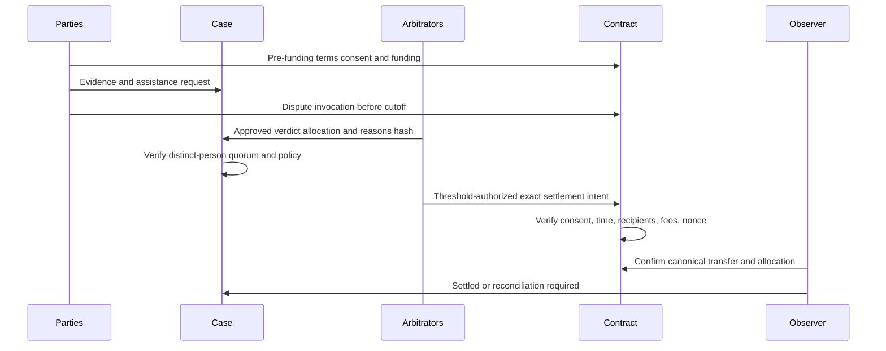

# Dispute assistance and authorized arbitration

These are separate capabilities. Current dispute records do not constitute arbitration consent or a confirmed transfer; see [audit](M0-REPORT.md). Funds authority and deadline precedence are defined in [escrow-security](escrow-security.md).

## Assistance and proposals

Either verified participant may open a case for their funded escrow. A case has `appId`, escrow scope, opener binding/version, reason, status, assigned support staff, immutable evidence versions and proposal history. Allow one active case per scope while permitting both parties to contribute. Support may request information, summarize statements and suggest allocations. App API-key identity alone cannot impersonate a client/worker response or approve settlement.

Case states: open → awaiting_submissions → assisting → proposal_pending → agreement_reached or arbitration_requested or closed_without_agreement. Settlement status is a separate projection; agreement_reached is not paid. Closing a case does not consume or release funds. Support actions are app-scoped and audited. Optional email contains a case reference and authenticated console link, never an attachment URL, approval token or funds command.

`Proposal(caseId, revision, termsHash, W, C, feeBreakdown, expiresAt, authorBinding, contentHash)` is immutable. Any change creates a new revision; approvals identify exact proposal hash, binding, signature and time. Both signatures on the same valid intent are required for mutual release, refund or arbitrary split. Expired/withdrawn proposals cannot be newly approved. Already signed chain-valid intents require chain nonce invalidation or expiry to be revoked; a UI withdrawal cannot promise revocation. Use short explicit intent lifetimes and show pending alternatives. Recommend only one offered active revision but treat races cryptographically.

## Consent and arbitration selection

At creation the app proposes a policy containing application-controlled adjudicators, threshold, immutable authority verifier/set hash, case rules, deadlines, permitted allocation range, fees and fallback. Both client and worker accept its digest and deployment/network scope **before funding**. Opt-out is fully supported with the mutually accepted fallback. PactAgent is not the default adjudicator. No consent means support cannot unilaterally decide or settle.

On Base, a party's on-chain dispute invocation before the cutoff activates the committed arbitration path. CKB v2's recommended simpler permission is enabled by pre-funding consent and does not promise Base's expiring invocation semantics; its explicit deviation and approval gate are in escrow-security. Off-chain request and on-chain invocation are tracked separately; show activation as pending until observed. Staff can submit a party's signed invocation, but cannot fabricate it. Contracts deployed in M2/M8 include this primitive even before M7 dashboards exist. Recommended initial policy disallows post-funding opt-in, arbitrator replacement or threshold weakening. Future amendments require both parties and reviewed on-chain enforcement, never just an API update.

Organization verdict approvals collect N unique person IDs from assigned authorized arbitrators, excluding conflicted parties and approvals by a proposer if the policy requires separation. Then threshold wallet/CKB cryptographic condition enforces the committed signer policy. These are separate controls: collecting N database approvals is not N signatures, and N keys are not proof of N people. Pin signer/threshold semantics to prevent an app owner reconfiguring a Safe after consent to bypass them.

Verdict carries case revision, evidence-manifest hash, terms hash, W/C allocation, policy hash, expiry and intent nonce. Reasons stay private; public chain includes only necessary commitments. Arbitrators cannot change asset, fee rate, treasury, parties or principal. A compromised threshold can choose an unfair allocation within [0,P]; it cannot withdraw to itself. This is an explicit residual trust accepted by both parties, not eliminated by noncustody.

## Evidence storage and access

Two-sided evidence includes statements, files/images, worker proof and proposals. Upload to a private quarantine bucket using one-object, tenant/case-bound, short-lived upload grants; recommend five-minute access URLs. Enforce byte/count quotas, extension and actual MIME checks, malware scanning, archive expansion limits, metadata stripping for served previews and isolated image/document transforms. Never execute active HTML/SVG/document macros. External links are untrusted; do not server-fetch arbitrary evidence URLs (SSRF). Store raw bytes privately, SHA-256 hash, immutable object/version ID, uploader binding, scan result and timestamps. Hash proves integrity, not truth.

Only clean versions are viewable by participant members of that case and explicitly assigned support/arbitrators. ACL is checked before every URL issuance and preview; URLs are bearer grants and should expire quickly. No public object ACLs or stable attachment links in email/webhooks. Changes create new versions, and verdicts bind an evidence manifest. Submission signature attests the content hash and case scope; app assertions alone are marked unverified. Audit access and download grants; redact private material from logs. Legal retention/hold periods and region are D10, required before real evidence collection; deletion removes permitted objects while retaining minimal non-content audit commitments as legally allowed.

## No-consent, timeout and failure handling

Without arbitration: mutual agreement or the explicit pre-funding fallback at T. A support case does not freeze the chain. On Base with arbitration: before T, mutual agreement or properly invoked arbitration; at T, only fixed fallback. CKB v2 uses lower-bound fallback eligibility with competing valid mutual/arbitral spends unless a stronger time/state protocol is reviewed; first canonical spend wins and this difference must be accepted before funding. See D04 for approval of these recommended semantics. Notify both parties well before cutoff, adjudication deadline and fallback eligibility. Test exact boundaries, delayed inclusion and competing transactions.

If an arbitrator disappears, fallback ensures a bounded exit. Lost participant keys may prevent mutual approval but cannot justify operator substitution. If both sign an unfair fallback, infrastructure cannot repair that economically without new authority; ensure conspicuous disclosure. Provider downtime, token blacklisting or chain halt can still delay exit; retain state and provide direct execution/recovery instructions. Case resolution and optional email delivery never override chain validity or finality.
