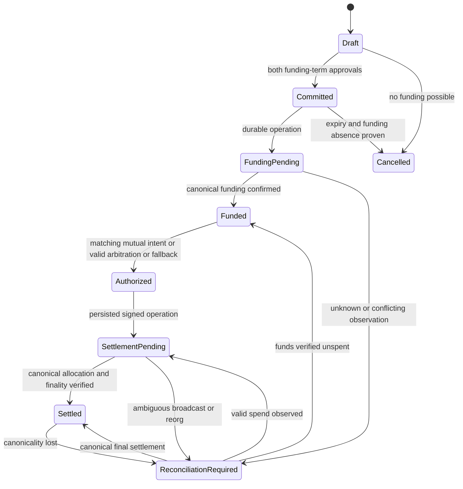

# Escrow authorization and settlement security

Proposed M0 contract; see [decisions](M0-DECISIONS.md) for defaults requiring approval and [fee equations](fees-billing.md) for allocations. Existing CKB v1 is not described by these new capabilities.

## Unified state and authority



| State | Source of truth and permitted effect |
| --- | --- |
| Draft/Committed | Versioned terms plus verified party signatures; not funded |
| FundingPending | Durable funding operation; no settlement or earned-volume billing |
| Funded | Contract balance/escrow state or exact live committed cell verified at configured finality |
| Authorized | Immutable valid intent/proofs; no paid status |
| SettlementPending | Signed operation and observed transaction; reserve scope, show pending |
| Settled | Canonical receipt/output allocation plus finality policy; emit paid and capture billing |
| ReconciliationRequired | Uncertainty; retain scope and billing reservation, reject conflicting operations |
| Cancelled | Never funded and expired/revoked funding authorization, with on-chain absence verified |

Dispute/support case state is orthogonal. A database verdict cannot transition directly to Settled. Failed broadcast is not evidence of unspent funds. Timeout eligibility is a predicate over committed chain time/height, never a server cron granting money authority.

## Frozen terms and signed intents

Before funding, both client and worker approve a `FundingTerms` commitment: protocol/version, deployment identity, chain/network, appId, agreementId, milestoneId, random escrowId/salt, AssetId, principal P, client/worker recipients and authorization identities, client/worker fee bps, treasury version/destination, fee algorithm version, arbitration enabled flag, arbiter policy/address/hash, dispute cutoff, adjudication deadline, final deadline, fallback allocation and capacity ownership. Terms include funding expiry. Recipient and authority may differ only through an explicit verified binding included in both approvals.

```ts
type SettlementIntent = {
  protocol: 'PactAgent'; version: '2';
  networkId: string; deploymentId: string; appId: string;
  escrowId: string; termsHash: string; assetId: string;
  action: 'mutual' | 'arbitrate' | 'fallback';
  nonce: string; proposalRevision: string; validUntil: string;
  principalWorker: string; principalClient: string;
  clientFeeConsumed: string; clientFeeReturned: string;
  workerFee: string; workerNet: string; clientNet: string; treasuryNet: string;
  authorizationPolicyHash: string;
};
```

All amounts/nonces are canonical unsigned integer base-unit strings at API boundaries, fixed-width integers in chain encoding. Escrow scope and immutable terms determine recipients; caller-supplied destinations must match byte-for-byte after chain canonicalization. Contract recomputes fees from principal allocation, rather than trusting signed net fields. Reject mismatched total, overflow, duplicate recipients where accounting is ambiguous, invalid expiry and unsupported action. Both parties approve **the same hash**, not independent UI selections. A proposal revision invalidates prior application approvals; previously signed still-valid chain intents cannot be revoked by a database edit. Recommended v2 is one terminal settlement per milestone, nonce 0 consumed once; multiple partial withdrawals are deferred. Custom split is a terminal allocation, not incremental withdrawal.

Base: EIP-712 domain `name=PactAgentEscrow`, `version=2`, chainId and verifyingContract. Hash typed fields in a fixed published order; hash strings as UTF-8 and nested terms as typed structs. Use vetted ECDSA recovery with low-s enforcement; contract wallets use ERC-1271. Recheck validity at execution, since smart-wallet owners may change. Funding signatures use a separate typed action from settlement. Global uniqueness is deployment+escrowId; appId remains signed metadata. Domain separation also applies to treasury verification, account login and evidence submission; none is a settlement signature.

CKB v2: specify and publish canonical fixed-width little-endian/Molecule terms and witness schema with versioned personalized CKB hash; commit genesis/network identifier, script code identity, exact escrow outpoint, terms hash, action, nonce and output allocation. Never sign JSON serialization. The reviewed lock/signature implementation must bind the transaction to those bytes and require client **and** worker for mutual paths, or the committed threshold arbiter condition for arbitral paths. UTXO consumption supplies single-spend protection; an API nonce alone is insufficient. Publish cross-language vectors before deployment.

HTTP idempotency is app+key+canonical request hash, rejecting the same key with different terms. Durable operation uniqueness additionally binds escrow+nonce+action intent hash; retries with a different HTTP key cannot pay twice. Persist signed transaction identity before broadcast. EVM replacements retain the same semantic intent and account nonce; CKB fee replacement retains identical committed payouts and proven unspent input. Unknown/replaced transactions are reconciled before any new authorization.

## Timeouts, arbitration and liveness

Recommended policy requiring product/security approval (D04): no arbitration means mutual settlement before final deadline T, then permissionless execution of a **pre-signed fixed fallback allocation**, not automatically full client refund. Both parties accept this allocation before funding. A support ticket does not pause chain time. For arbitration-enabled escrows, a party can invoke on-chain dispute before cutoff D; while disputed, arbitral execution is allowed until A; fallback executes from T, with D < A = T. Mutual settlement remains possible before T. On Base, at/after T only fallback is valid. Use non-overlapping `< T` and `>= T` predicates; exact boundary and transaction races require tests. No repeated deadline extension by staff or by opening cases. A dispute invoked late cannot retroactively stop a fallback.

CKB deviation: `since` enforces a lower bound, not a trusted current-height upper bound. An old header dependency must not be used to pretend that an arbitration deadline has not passed. Recommended initial CKB v2 permits fallback from T while previously valid mutual/arbitral paths remain spendable; the first canonical valid spend wins. It cannot promise Base's exclusive cutoff or cryptographic signature expiry without an additional reviewed protocol. For CKB, `validUntil` is an API submission policy only, not a claim of on-chain revocation; consent must disclose this. Use immutable pre-funding arbiter permission rather than assume an expiring dispute-activation flag is expressible in the v1 cell model. If exclusive deadlines or invocation-gated arbitration are required uniformly, keep CKB v2 arbitration disabled until a separately reviewed state-cell/time construction proves them. This D04/D07 choice is a pre-M8 gate.

Choose deadlines and fallback shares per escrow within published safety bounds before funding; reject unset parameters. This trades a predictable escape path against possible unfair fallback if keys/arbitrators are lost. Disclose that risk, give clients direct-chain dispute/settlement tooling, and do not claim perfect fairness. Lost user keys cannot be reset by support to drain funds. Smart-wallet recovery is user-controlled; replacing recipients in a funded escrow is forbidden. Post-funding arbitration opt-in is rejected for initial v2; any future amendment needs both signatures and a new audited on-chain amendment primitive, not an API flag. CKB v1's already-committed unconditional timeout refund cannot be paused or changed.

## Base native USDC contract blueprint

Recommend factory-created immutable escrow per milestone over a pooled balance contract: more gas/deployments, smaller accounting blast radius and simpler isolation. No upgrade/admin sweep of escrowed USDC. Factory configuration affects future instances only. Each instance binds token, principal, recipients, treasury, fee algorithm, arbitral policy, deadlines and fallback at creation; verify both funding signatures before accepting funding. M2 verifies official Base Sepolia chain configuration and native USDC deployment before enabling it; Base mainnet remains blocked.

Funding uses explicit exact allowance and `transferFrom` of P plus client fee deposit, verifies balance delta, and marks funded once. Direct token donations do not create a funded record or change distributable principal. Use audited SafeERC20, non-reentrancy and checks-effects-interactions; reject fee-on-transfer/rebasing tokens. Atomically mark consumed nonce/state and transfer computed outputs; a failed token transfer reverts the whole settlement. Validate zero addresses, allowed asset and bounds before signatures; skip zero-value outputs. No arbitrary call/delegatecall or allowance granting to an operator. Token issuer pause/blacklist can prevent payout even with valid authorization; preserve claims and retry after remediation, never reroute by operator choice.

Arbitration authority is committed from day one: both pre-funding consents plus an immutable per-escrow policy hash and arbiter verifier. Recommend immutable threshold signer set or dedicated constrained Safe policy/module whose signers/threshold cannot change for that escrow without the original parties' authority. A mutable Safe address alone does not pin who may adjudicate. Contract permits only original recipients and deterministic treasury fees; arbitrators choose W in [0,P], not arbitrary recipients or fees.

Events: `EscrowCreated(escrowId,termsHash)`, `Funded(escrowId,asset,amount)`, `DisputeInvoked(escrowId,policyHash)`, `Settled(escrowId,intentHash,nonce,W,C,treasuryNet)` emitted only after successful transitions. Index by deployment+chain+txHash+logIndex with block hash and removal/reorg handling. Verify receipt success, emitter bytecode/deployment, token movements and contract state; token Transfer logs alone do not establish escrow settlement.

## CKB v1 evidence and v2 upgrade

Current [lib.rs](../../contracts/pact-escrow-lock/src/lib.rs) `evaluate_spend` (line 124) accepts one full-capacity worker output with a client-authorized input, or one full-capacity client output with a worker-authorized input, or an absolute-block `since` timeout. [main.rs](../../contracts/pact-escrow-lock/src/main.rs) line 54 collects input lock hashes; those inputs' locks supply actual cryptographic checks. This is not direct verification of two off-chain signatures. GroupInput count is restricted, but cross-group output reuse needs adversarial VM analysis. No split/fee/arbiter witness exists.

V2 must commit principal separately from capacity reserve, client fee reserve, both party lock identities, fixed treasury, explicit threshold policy, chain identity, deadlines and fallback. Adopt a reviewed witness verifier (e.g. pinned audited CKB authentication library with supported algorithms) for exact intent digest and distinct arbiter keys, or equivalently reviewed transaction-wide lock authorization with proofs that bind all required signers. Selection of library/algorithm is D07, a pre-M8 gate. Do not infer arbitrary CCC connector transaction compatibility.

Enforce one escrow input across the entire transaction initially, not just a lock group, with unique settlement outputs and no escrow recreation. Check exact untyped output data/lock/capacity, total capacity conservation, and all recipient output minima. Capacity needed for client/worker/treasury outputs is separately committed and funded; reject allocations that cannot produce valid cells unless external committed top-ups cover them. Never silently confiscate dust or use principal for gas. Fee inputs and their change must be independently accounted for. Define ownership/return of reserve to original contributors in terms; freeze this at funding. Publish binary layout, hash vectors, capacity bounds, multisig rules and full VM transactions in M8. Leave old code hash, data and historical cells intact; v1 continues using its original adapter, without new capabilities or inferred consent.

## Confirmation and privileged operations

Base policy recommendation: pending after inclusion; confirmed for billing/paid only when receipt block is canonical under Base's finalized head with documented L1 dependency. Sequencer soft confirmation is insufficient. CKB: configurable confirmation depth plus canonical block-hash comparison and ongoing historical sweeps, with production depth chosen from documented risk review. Current default four confirmations is not a mainnet recommendation. BTC policy deferred to M11. Store policy version on each escrow; never lower a funded escrow's threshold silently.

On canonicality loss emit correction, revoke paid projection, compensate billing and reconcile before retrying. Compare stored and observed block hashes even if a transaction remains committed. Provider disagreement or stale finalized heads fails closed. Operators can disable new funding, change future registry entries, rotate service credentials and retry observations; they cannot cancel valid settlement rights, change balances, mutate frozen recipients, override signatures or withdraw principal. Emergency pause should stop creation/funding only; any broader pause needs explicit reviewed liveness design.
