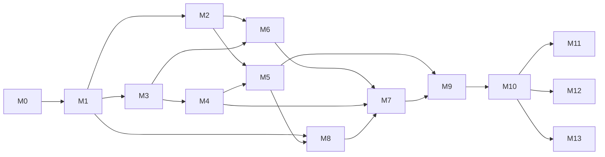

# M1–M13 implementation contracts

M0 produces this plan only. Starting a milestone requires explicit authorized scope and its prerequisites; this document does not authorize execution, deployment or fund movement. [Decisions](M0-DECISIONS.md), [threat model](../security/threat-model.md) and [M0 handoff](M0-REPORT.md) supply unresolved gates.

## Dependency map

Milestone numbers are labels, not a strict sequential dependency. M7's CKB execution acceptance depends on M8; its UI can develop against M0-approved interfaces earlier. M2 and M8 ship and test the frozen arbitration primitive from day one, even before M7 workflows. Base launch may proceed through a scoped M10 Base gate with legacy CKB preserved and CKB v2 disabled if M8 is unfinished; never advertise unfinished CKB capabilities.

## Work contracts

| Milestone | Goal, dependencies and interface contract | Acceptance evidence and explicit boundary |
| --- | --- | --- |
| M1 | Registry, rail capabilities, additive asset/terms/operation/observation models and versioned API groundwork. Depends on accepted M0 interface decisions. Inputs: AssetId, FrozenTerms, SettlementIntent, Observation. Outputs: typed contracts, additive migration, capability errors and documented v1/v2 boundary. | Unit/property tests for precision and bounds; cross-tenant/same-tenant wrong-parent constraints; populated upgrade fixture; legacy CKB bytes/outpoints unchanged; OpenAPI compatibility. No new real-money rail, schema cleanup or inferred consent. |
| M2 | Native USDC Base Sepolia contract/adapter. Depends M1, D02/D03/D04/D09. Official Circle/Base deployment and chain facts verified with dated source evidence. Implement immutable funding consent, release/refund/custom split, arbitral verifier, invocation and fallback, events and reconciliation. | Full Sepolia lifecycle with both-party proofs; nonconsensual/arbitrary-recipient attempts revert; token/allowance/reentrancy/failure tests; fuzz conservation/replay; ambiguous broadcast and reorg recovery; contract artifact/deployment manifest. No unverified token or mainnet enablement. |
| M3 | Console stable accounts, invitations and many-role app membership. Depends M1, D11/D12. Inputs: verified account identity and invitation. Outputs: membership/grant versions and permission evaluation. | Negative connector/address binding tests; expiry/replay/revocation tests; additive permissions and separation-of-duties; one person cannot count twice; owner cannot acquire funds rights. No customer login framework. |
| M4 | Verified versioned treasuries, Safe/CKB multisig and high-risk config approvals. Depends M3 plus M2 wallet verification patterns where needed. Inputs: network-specific control proof and approval policy. | EOA/ERC-1271 and supported CKB lock vectors; stale proof and changed threshold tests; two-person step-up and invitation abuse tests; funded destination immutability. No key/seed collection; unsupported wallets rejected. |
| M5 | Independent app fee policies and prepaid B2B billing. Depends M1/M2/M4 and approved commercial/collection D05/D06. Interface: fee algorithm version, BillingReservation, balanced Journal and confirmed-settlement observation. | All fee modes/refund/custom split/dust/max vectors; property conservation; concurrent credit reservations; duplicate captures; backing reconciliation and reorg reversals; insufficient credit blocks only creation. No collection from escrow; CKB cross-currency path disabled without approved pricing/cap. |
| M6 | Two-sided evidence, nonbinding assistance, versioned proposals and notifications. Depends M2/M3; approve D10. Interface: case-scoped evidence manifest, proposal hash and user approval proofs. | Both sides upload/respond; quarantine/scan/access/URL expiry tests; proposal revision races; email has no authority; no-consent cases cannot cause unilateral payment. No implied PactAgent adjudication. |
| M7 | App-configured consent, arbitrators, verdict approvals and contract-enforced execution on Base and CKB. Depends M4/M6, M2 and M8 for each rail's completion. Interface: pinned policy, distinct-person quorum, chain-valid threshold authorization. | No consent/late consent rejected; signer threshold and original-recipient bounds enforced on actual transactions; conflicting roles/duplicate persons tested; verdict/pending/confirmed separated; fallback and compromised arbiter scenarios. Do not retrofit mutable authority into funded contracts. |
| M8 | CKB v2 custom split, fees and arbitration. Depends M1, M0-approved primitive, M5 arithmetic, D07 implementation decisions. Interface: versioned script args/data/witness, capacity ownership and supported signers. | Transaction-level VM tests for signatures, `since`, thresholds, exact outputs, multi-group reuse, external fee inputs and output minima; binary/hash vectors; old v1 spends preserved; reviewed code/deployment identity. No in-place historical cell mutation or production claim from host unit tests. |
| M9 | Versioned APIs/SDKs, examples, sandbox and webhook contracts. Depends stable M2/M5/M6/M7 interfaces for advertised capabilities; CKB v2 examples gated by M8. | Generated/validated OpenAPI, v1 compatibility, SDK wallet/network rejection tests, raw-body signature and timestamp verification, duplicates/reordering/reorg corrections, complete integration guide. No browser API secrets or unsupported capability claims. |
| M10 | Adversarial integration/staging and operational/security launch gate. Depends all features enabled in launch scope; Base requires M1–M7/M9 and applicable M2 tests, CKB v2 additionally M8. | Independent contract/security findings disposition; crash/provider/reorg/restore drills; reconciled balances, alert ownership, key rotation and incident runbooks; controlled testnet evidence; regulatory review and named release approval. Mainnet remains blocked until gate passes; deployment requires separate authorization. |
| M11 | Native Bitcoin escrow after independent Bitcoin design/security review. Depends stable M10 core, not a prerequisite to Base. Interface: BTC AssetId/capabilities, PSBT/UTXO/signing/timelocks, fee and confirmation policies. | Review script/threshold/fallback/recovery design before implementation; regtest/testnet adversarial spends, dust/fee bump/reorg vectors and own launch gate. Do not assume EVM arbitration or CKB witnesses map to BTC. |
| M12 | Optional provider-neutral CKB↔USDC swaps. Depends M10 and verified compatible routes. Interface: quote(provider, assets, exact/min output, slippage, expiry), execute, observe, refund/recover. | Dated route/provider verification, fees/price risk disclosure, partial fill/timeout/wrong asset/failure recovery tests; output must independently fund an escrow. If no viable route, remain deferred; direct USDC/CKB continues. |
| M13 | Demand-led future rails and optimizations. Depends measured demand and M10 governance. Interface: existing capability registry/observation contracts with explicit deviations. | Independent chain/security review, capability test suite, migration/rollback design and per-rail launch gate. No generalized token acceptance or pooling without review. |

## Shared implementation acceptance

Every money change includes positive and adversarial tests for authorization, conservation, replay, timeout races and tenant scope, appropriate to its implementation layer. Record exact commands and outcomes; skipped tests are not passes. Runtime changes follow repository lint/test/build/OpenAPI checks, DB integration/upgrade checks when applicable, and actual chain VM/transaction tests for contract authorization. Update API examples and decision/threat registers alongside changes.

Testnet gates require deterministic artifacts, verified deployments/configuration, no production credentials, faucet-only funds and evidence of the complete settlement lifecycle including failure paths. Mainnet gates additionally require independent security review appropriate to the chain, resolved critical/high findings, legal/regulatory review, monitored confirmations/reconciliation, separately backed billing, operational ownership, incident and recovery drills, reviewed wallet custody boundaries and an explicit launch decision. A successful M0 review or CI build is not that decision.
