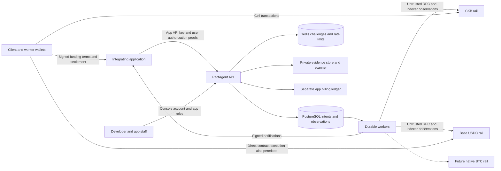
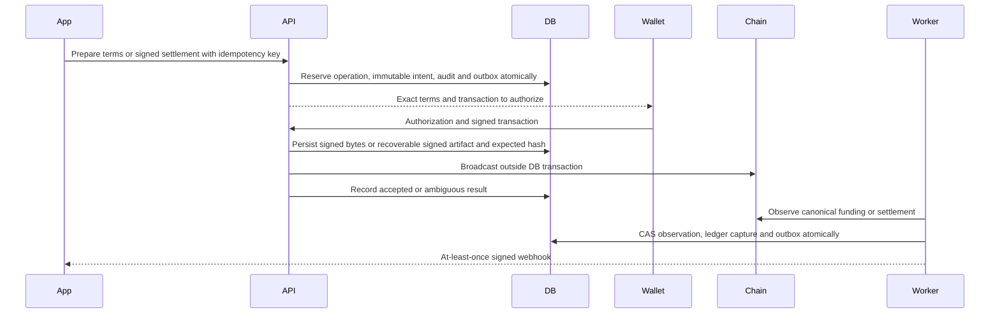

# M0 system design

Current status (2026-10-31): [product-direction approval](M0-PRODUCT-APPROVAL.md) supersedes historical pending product labels below. Specialized reviews remain OPEN. [M1 implementation](M1-IMPLEMENTATION.md) records the additive foundation and its limits; the original M0 design/review remains historical.

Status: implementation blueprint, 2026-10-27. The [M0 specification](../../M0_ARCHITECTURE_SPEC.md) is authoritative. Existing implementation evidence is in [M0-REPORT](M0-REPORT.md); recommendations requiring acceptance are in [M0-DECISIONS](M0-DECISIONS.md). Nothing below claims deployed functionality.

## Context and trust boundaries



App is the tenant. Obtain appId from the authenticated API key or active console membership, never a supplied body field. Scope reads, writes, cursors, blob access, events, jobs and billing to this tenant. Composite foreign keys additionally bind agreement/milestone/escrow relationships. Operators may observe and recover jobs under audited privileges; they cannot rewrite funded terms or authorize transfers.

PostgreSQL is authoritative for application intent, authorization records and accounting, **not chain ownership or settlement finality**. Chains are authoritative for funds. RPCs supply observations that must be checked against canonical blocks and committed outputs. Redis is disposable except that loss of challenges must fail authentication closed. Object store possession does not grant evidence access. App authentication establishes a customer session; wallet proofs independently authorize funds.

## Module contracts

Keep the modular monolith and separate API/worker processes. Retain routes → controllers → services → repositories. Extend existing escrows, disputes, events and transactions modules; add focused asset-registry, identities/memberships, treasury, authorizations, evidence and billing modules when their milestone starts. Do not put product matching, registration or work-quality adjudication in the core.

```ts
// Proposed contract, not a current exported interface.
type AssetId = string; // immutable registry key, canonical encoding below
type BaseUnits = string; // canonical unsigned decimal, arithmetic via bigint
type Capability = 'fund' | 'release' | 'refund' | 'split' | 'arbitrate';
interface EscrowRail {
  descriptor(): { rail: string; networkId: string; version: string;
    capabilities: Capability[]; authorizationScheme: string };
  create(terms: FrozenTerms): Promise<PreparedOperation>;
  fund(terms: FrozenTerms, authorization: Authorization): Promise<PreparedOperation>;
  release(intent: SettlementIntent, proof: Authorization): Promise<PreparedOperation>;
  refund(intent: SettlementIntent, proof: Authorization): Promise<PreparedOperation>;
  split(intent: SettlementIntent, proof: Authorization): Promise<PreparedOperation>;
  arbitrate(intent: SettlementIntent, proof: Authorization): Promise<PreparedOperation>;
  broadcast(op: PersistedSignedOperation): Promise<BroadcastResult>;
  observe(ref: ChainReference, policy: ConfirmationPolicy): Promise<Observation>;
}
```

`FrozenTerms` is the commitment in [escrow-security](escrow-security.md). `PreparedOperation` holds unsigned bytes, terms hash, required authorizers, gas/capacity needs and deterministic operation ID; preparation cannot move funds. `Authorization` distinguishes mutual signatures, committed arbitral authorization and precommitted fallback. `BroadcastResult` is accepted/rejected/unknown with expected transaction identity; it never means paid. `Observation` includes canonical block hash/height, receipt or spent-output proof, allocation, confirmations/finality, and observation time. Unsupported capabilities return `unsupported_rail_capability` before funding. Never silently emulate a split with two independent payouts.

## Assets and rail separation

Registry key: `<namespace>:<chainReference>/<assetKind>:<assetReference>`. Base uses `eip155:<chainId>/erc20:<canonical lowercase address>`; CKB uses `ckb:<genesisHash>/native:ckb`; future Bitcoin uses `bip122:<genesisReference>/native:btc`. Sandbox assets have a separate namespace and cannot be promoted to real assets. Namespace/reference validation belongs to the rail. Registry pins precision, verified issuer, deployment evidence, enabled environments, transfer behavior and amount maximum. A ticker is display metadata, never an identifier.

Native USDC precision is six decimal places; CKB is eight, BTC eight. Verify token deployment/decimals with official Circle and Base sources in M2; M0 intentionally supplies no deployment addresses. Use integer strings and checked bigint arithmetic; current uint64 CKB constraints cannot be applied blindly to EVM uint256. Invalid, bridged, fee-on-transfer or rebasing tokens are not native USDC and must be rejected.

Base is account/nonce based with ETH gas outside USDC principal. CKB is cell/outpoint based with occupied-capacity constraints and separate fee inputs. BTC requires independent UTXO/script, PSBT, fee and timelock design/review in M11. CKB v1 remains separately versioned with its actual limited capabilities. Swaps are a separate quote/execution service in M12 and never a prerequisite for direct escrow.

## Event and recovery flow



Persist before broadcast to close crash windows; never rely on HTTP success to reconstruct signed bytes. Recover by operation ID, expected hash, contract escrow nonce or outpoint. Leased jobs with owner-checked completion and bounded backoff are retryable; chain writes require identical operation semantics. Lease expiry does not justify signing a second settlement. Dead letters alert an operator and leave funds in reconciliation, not reusable scope.

Outbox payloads are immutable, with event ID, appId, aggregate ID/version, schema version, correlation ID and observed block reference. Delivery can duplicate or arrive out of order. Consumers deduplicate event IDs and fetch current state on version gaps. Reorg corrections are new events and compensating ledger entries, never edits to historical delivery bodies. Periodic canonical-chain sweeps supplement event subscriptions and shallow confirmation jobs; provider disagreement freezes new confirmations and alerts operations.

## Application and SDK responsibilities

Applications own end-user login, business rules, support staffing and explicit arbitration policy. SDKs prepare/display canonical terms, collect supported wallet signatures, verify webhook timestamp/signature, retry using the same idempotency key and expose pending/reorg states. They never hold app API secrets in browsers or translate app API-key authority into user signatures. Console wallet login and payment wallet capability checks are separate. Users need documented direct-chain recovery/execution paths if PactAgent or the app is unavailable.
